<div align="center">

# Camsur AI Studio

**Turn everyday selfies into studio-quality photos with AI.**

Headshots, LinkedIn profiles, passport photos and background edits, all from your phone.

[](LICENSE)
[](camsur-flutter)
[](camsur-backend)
[](https://supabase.com)
[](https://www.python.org)

<br>

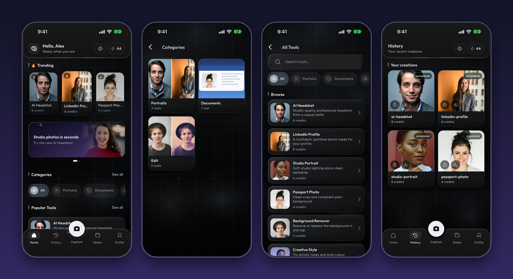

</div>

---

## Table of contents

- [About](#about)
- [Screenshots](#screenshots)
- [Features](#features)
- [How it works](#how-it-works)
- [Repository layout](#repository-layout)
- [Tech stack](#tech-stack)
- [Quick start](#quick-start)
- [Security](#security)
- [Contributing](#contributing)
- [License](#license)

## About

Camsur AI Studio is a full-stack AI photo app. A user picks a tool (for example *AI Headshot*), adds a selfie, and gets back a clean, studio-quality photo in seconds.

The project has two parts:

- A **Flutter mobile app** for the user experience.
- A **FastAPI backend** that handles accounts, credits, storage and the AI image generation.

It is a complete, real-world example of a credit-based AI product: sign-in, a pay-per-use credit wallet, safe AI calls, cost tracking and an admin API.

## Screenshots

> Screenshots are taken from the real app on an iPhone simulator. They use demo data and free stock portraits from [Unsplash](https://unsplash.com) ([Unsplash License](https://unsplash.com/license)) as sample images. No real accounts are shown, and the "before and after" examples are illustrative, not real AI output.

<table>
  <tr>
    <td align="center">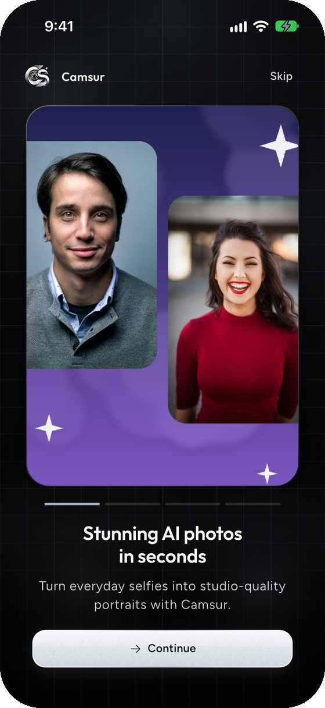<br><sub><b>Onboarding</b></sub></td>
    <td align="center">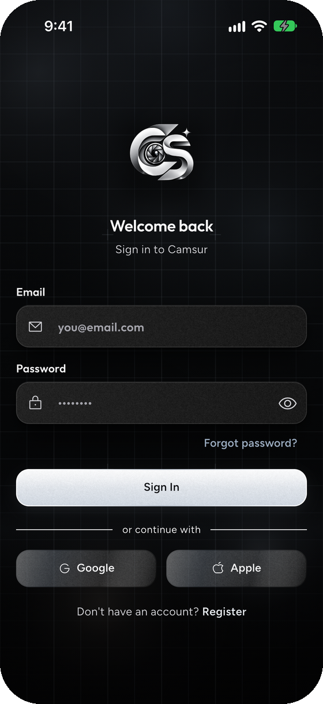<br><sub><b>Sign in</b></sub></td>
    <td align="center">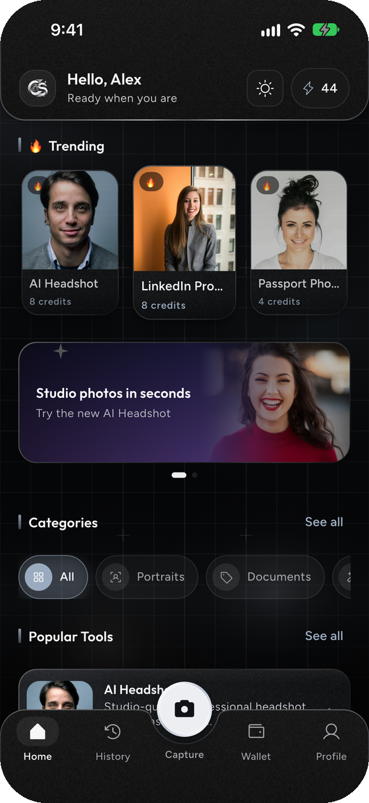<br><sub><b>Home</b></sub></td>
  </tr>
  <tr>
    <td align="center">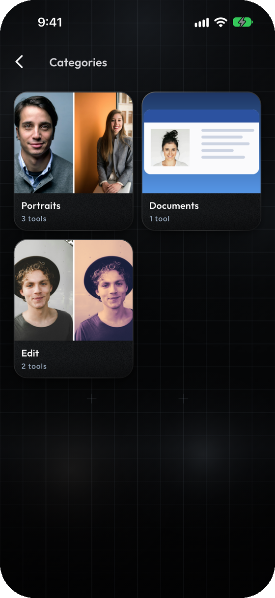<br><sub><b>Categories</b></sub></td>
    <td align="center">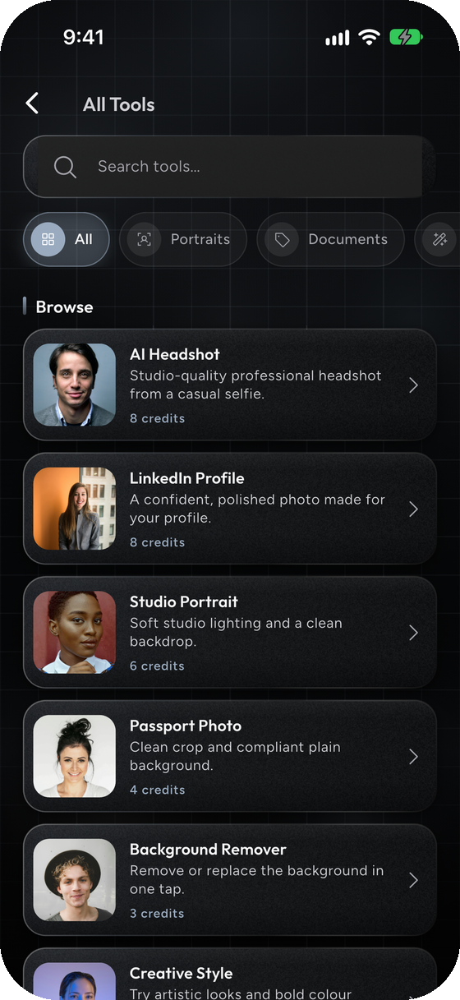<br><sub><b>All tools</b></sub></td>
    <td align="center">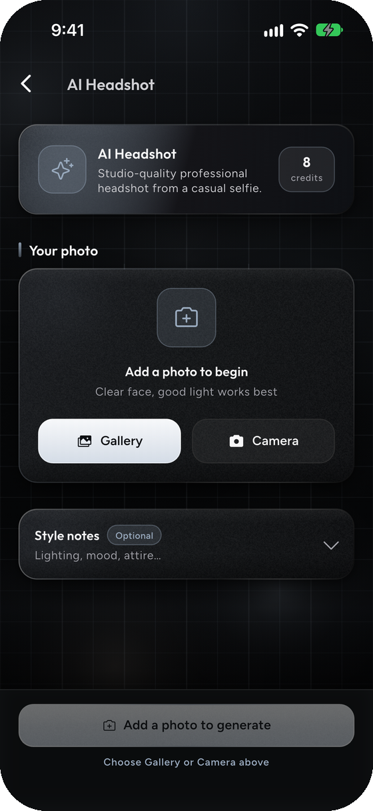<br><sub><b>Pick a tool</b></sub></td>
  </tr>
  <tr>
    <td align="center">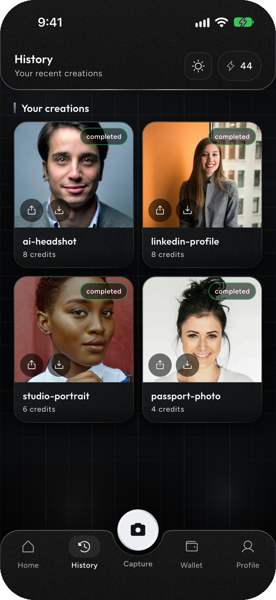<br><sub><b>History</b></sub></td>
    <td align="center">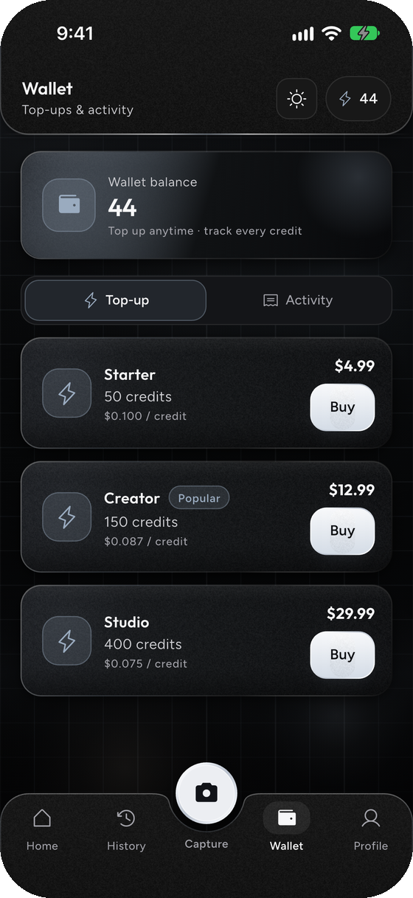<br><sub><b>Credit wallet</b></sub></td>
    <td align="center">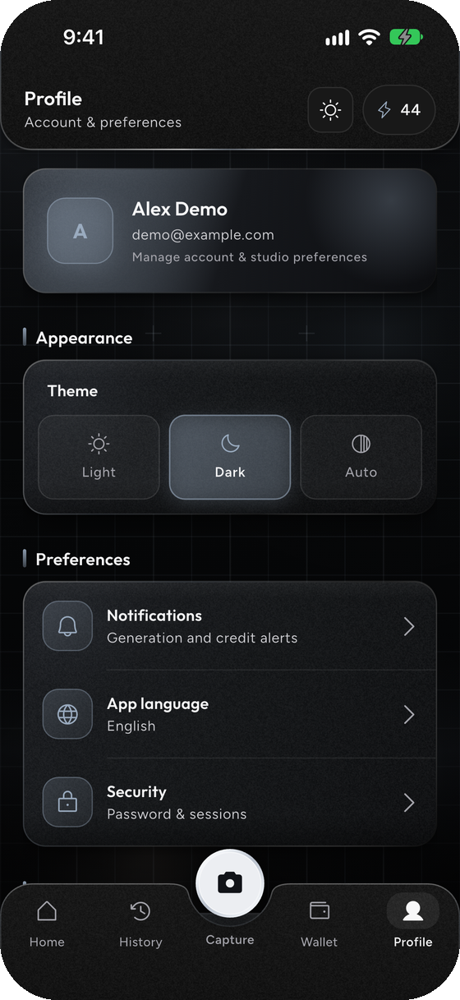<br><sub><b>Profile and themes</b></sub></td>
  </tr>
</table>

## Features

### Mobile app

- Email and password sign-up, plus **Google** and **Apple** sign-in
- A catalog of AI photo tools with categories, trending tools and banners
- Add a photo from the gallery or camera, add optional style notes, then generate
- Before and after comparison, and save or share your results
- A **credit wallet** with top-up packs and a full activity log
- Generation history
- Light, dark and auto themes
- Smooth onboarding, shimmer loading and image caching

### Backend

- **Auth** through Supabase (email, Google, Apple)
- **Credits ledger**: spend, refund and grant are atomic and safe to retry
- **Auto refunds** when a generation fails
- **AI provider layer** using FLUX image models from Black Forest Labs
- **Cost controls**: per-user and global limits, rate limits and an emergency kill switch
- **Margin monitor** that turns off a tool if it starts losing money
- **Admin API**: users, tools, credit packages, analytics and refunds
- **Storage lifecycle**: uploads and results are deleted automatically after a set time
- Clear docs, SQL migrations and a unit test suite

## How it works

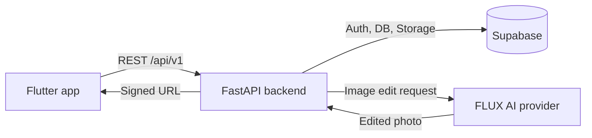

**What happens when a user generates a photo:**

1. The user signs in and picks a tool in the app.
2. The app uploads the selfie to the backend.
3. The backend checks the limits and the user's credit balance.
4. The credits are spent in one safe step.
5. The photo is sent to the AI model and the result is saved to private storage.
6. The app receives a secure link and shows the result.
7. If anything fails, the credits are **refunded automatically**.

## Repository layout

This is a **monorepo**: the app and the API live together in one repository.

```text
Camsur-AI-Studio/
├── camsur-flutter/    Flutter mobile app
├── camsur-backend/    FastAPI + Supabase API
├── docs/              README screenshots
├── LICENSE
└── README.md
```

| Folder | What it is | Tech |
|---|---|---|
| [**camsur-flutter**](camsur-flutter) | The mobile app | Flutter, Dart, GetX, Dio |
| [**camsur-backend**](camsur-backend) | The API server | Python, FastAPI, Supabase, FLUX |

Each folder has its own README with full setup steps.

## Tech stack

| Layer | Tools |
|---|---|
| Mobile | Flutter 3, Dart 3, GetX, Dio |
| Backend | Python 3.12, FastAPI, Pydantic, Uvicorn |
| Database and auth | Supabase (Postgres, Auth, Storage) |
| AI | Black Forest Labs FLUX |
| Testing | pytest, flutter test |
| Deploy | Render (optional, `render.yaml` included) |

## Quick start

You need: [Flutter](https://docs.flutter.dev/get-started/install), Python 3.12, a free [Supabase](https://supabase.com) project and a [Black Forest Labs](https://docs.bfl.ai) API key.

**1. Get the code**

```bash
git clone https://github.com/suraj-chavda/Camsur-AI-Studio.git
cd Camsur-AI-Studio
```

**2. Run the backend**

```bash
cd camsur-backend

python -m venv .venv
source .venv/bin/activate          # Windows: .venv\Scripts\activate
pip install -r requirements.txt

cp .env.example .env               # then add your Supabase and BFL keys

python scripts/run_schema.py
python scripts/run_storage_policies.py
python scripts/ensure_buckets.py
python scripts/seed_tool_catalog.py

uvicorn app.main:app --reload      # runs on http://localhost:8000
```

**3. Run the app** (in a new terminal, from the repo root)

```bash
cd camsur-flutter

flutter pub get
flutter run --dart-define=API_BASE_URL=http://localhost:8000/api/v1
```

> **Android emulator?** Use `http://10.0.2.2:8000/api/v1` instead of `localhost`.

## Security

- No secrets are stored in the code. Keys go in a local `.env` file (backend) or `--dart-define` flags (app).
- `.env`, keystores and signing files are in `.gitignore`.
- Tool prices are set on the server, never by the app.
- Credit changes use idempotent database functions, so retries never double-charge.
- Use your **own** Supabase project and API keys. Never commit them.

Found a security problem? Please contact the maintainer privately instead of opening a public issue.

## Contributing

Ideas and pull requests are welcome.

1. Fork this repository.
2. Create a branch: `git checkout -b my-change`
3. Make your change and run the tests.
4. Open a pull request that explains what you changed and why.

## License

Released under the [MIT License](LICENSE).

Copyright © 2026 Suraj Chavda

<div align="center">

Built by [Suraj Chavda](https://github.com/suraj-chavda)

</div>
